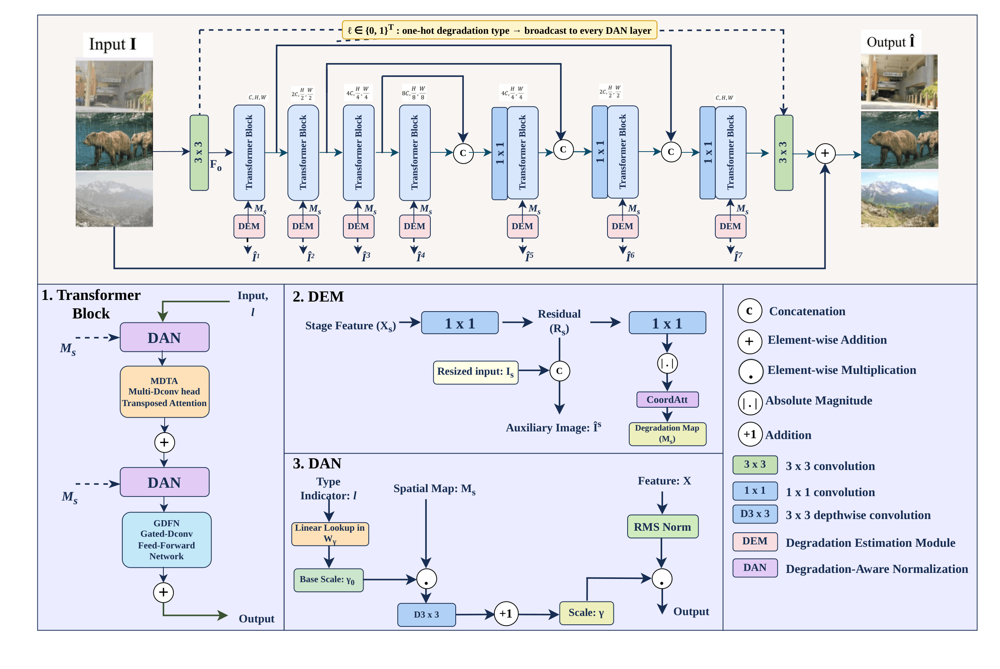

# ClearNet — All-in-One Image Restoration

**Accepted at WACV 2027**

**Authors:** [Abhinav Kumar, Aditya Chauhan, Laabhanvi Jain]

## Abstract

ClearNet is an all-in-one image restoration model that handles multiple degradation types (denoising, deraining, dehazing, deblurring, low-light enhancement) with a single unified network. It introduces Degradation-Aware Normalization (DAN) with a spatial degradation map to condition the shared backbone on the degradation type and its spatial extent, achieving state-of-the-art performance with only 26M parameters.

---

## Model Architecture



---

## Results

### Three-Degradation Setting (D3)

| Method | Dehazing (SOTS) |  | Deraining (Rain100L) |  | Denoise σ=15 (CBSD68) |  | Denoise σ=25 (CBSD68) |  | Denoise σ=50 (CBSD68) |  | Average |  |
|--------|:-----:|:-----:|:-----:|:-----:|:-----:|:-----:|:-----:|:-----:|:-----:|:-----:|:-----:|:-----:|
|        | PSNR | SSIM | PSNR | SSIM | PSNR | SSIM | PSNR | SSIM | PSNR | SSIM | PSNR | SSIM |
| MPRNet | 28.00 | .958 | 33.86 | .958 | 33.27 | .920 | 30.76 | .871 | 27.29 | .761 | 30.63 | .894 |
| Restormer | 27.78 | .958 | 33.78 | .958 | 33.72 | .930 | 30.67 | .865 | 27.63 | .792 | 30.75 | .901 |
| MambaIR | 29.57 | .970 | 35.42 | .969 | 33.88 | .931 | 30.95 | .874 | 27.74 | .793 | 31.51 | .907 |
| AirNet | 27.94 | .962 | 34.90 | .967 | 33.92 | .933 | 31.26 | .888 | 28.00 | .797 | 31.20 | .910 |
| IDR | 29.87 | .970 | 36.03 | .971 | 33.89 | .931 | 31.32 | .884 | 28.04 | .798 | 31.83 | .911 |
| PromptIR | 30.58 | .974 | 36.37 | .972 | 33.98 | .933 | 31.31 | .888 | 28.06 | .799 | 32.06 | .913 |
| InstructIR | 30.22 | .959 | 37.98 | .978 | **34.15** | **.935** | **31.52** | .890 | **28.30** | .804 | 32.43 | .913 |
| VLUNet | 30.71 | **.980** | **38.93** | **.984** | 34.13 | **.935** | 31.48 | .892 | 28.23 | .804 | 32.70 | **.919** |
| DFPIR | **31.87** | **.980** | 38.65 | .982 | 34.14 | **.935** | 31.47 | **.893** | 28.25 | **.806** | **32.88** | **.919** |
| ClearAIR | **31.08** | **.981** | 38.61 | **.984** | **34.18** | **.935** | **31.50** | .891 | **28.31** | .804 | 32.74 | **.919** |
| **ClearNet (Ours)** | 30.91 | .962 | **39.26** | **.986** | 34.11 | **.936** | 31.49 | **.894** | 28.26 | **.808** | 32.81 | .917 |

> On average PSNR, ClearNet provides a significant gain of **2.06 dB** over the base Restormer at the same parameter count (26M).

### Five-Degradation Setting (D5)

| Method | Params | Dehazing (SOTS) |  | Deraining (Rain100L) |  | Denoising* (CBSD68) |  | Deblurring (GoPro) |  | Low-light (LOL) |  | Average |  |
|--------|--------|:-----:|:-----:|:-----:|:-----:|:-----:|:-----:|:-----:|:-----:|:-----:|:-----:|:-----:|:-----:|
|        |        | PSNR | SSIM | PSNR | SSIM | PSNR | SSIM | PSNR | SSIM | PSNR | SSIM | PSNR | SSIM |
| Restormer | 26M | 24.09 | .927 | 34.81 | .962 | 31.49 | .884 | 27.22 | .829 | 20.41 | .806 | 27.60 | .881 |
| MambaIR | 27M | 25.81 | .944 | 36.55 | .971 | 31.41 | .884 | 28.61 | .875 | 22.49 | .832 | 28.97 | .901 |
| NAFNet | 17M | 25.23 | .939 | 35.56 | .967 | 31.02 | .883 | 26.53 | .808 | 20.49 | .809 | 27.76 | .881 |
| AirNet | 9M | 21.04 | .884 | 32.98 | .951 | 30.91 | .882 | 24.35 | .781 | 18.18 | .735 | 25.49 | .846 |
| IDR | 15M | 25.24 | .943 | 35.63 | .965 | **31.60** | .887 | 27.87 | .846 | 21.34 | .826 | 28.34 | .893 |
| PromptIR | 33M | 26.54 | .949 | 36.37 | .970 | 31.47 | .886 | 28.71 | .881 | 22.68 | .832 | 29.15 | .904 |
| InstructIR | 16M+17M | 27.10 | .956 | 36.84 | .973 | 31.40 | .887 | 29.40 | .886 | 23.00 | .836 | 29.55 | .907 |
| VLUNet | 35M+88M | **30.84** | **.980** | 38.54 | .982 | 31.43 | .891 | 27.46 | .840 | 22.29 | .833 | 30.11 | .905 |
| DFPIR | 31M+63M | **31.64** | .979 | 37.62 | .978 | 31.29 | .889 | 28.82 | .873 | **23.82** | .843 | **30.64** | .913 |
| ClearAIR | - | 30.12 | .978 | 38.20 | .982 | 31.53 | .888 | **29.67** | **.887** | 22.83 | .846 | 30.45 | **.916** |
| **ClearNet (Ours)** | **26M** | 30.61 | .962 | **39.16** | **.985** | 31.41 | **.893** | 28.59 | .881 | 23.03 | **.856** | 30.56 | .915 |

> *Denoising results are reported for noise level σ = 25.

### Efficiency Comparison (256×256, Tesla T4, batch 1, fp32)

| Method | GMACs | Latency (ms) | Memory (MB) |
|--------|------:|-------------:|------------:|
| Restormer | 154.9 | 269.0 | 708 |
| PromptIR | 172.7 | 281.7 | 757 |
| DFPIR | 168.4 | 282.7 | 1476 |
| VLUNet | 190.6 | 324.7 | 1424 |
| **ClearNet (Ours)** | **156.8** | **280.6** | **798** |

---

## Usage

### Training

Train on all five degradation types:

```bash
python train.py --de_type noise rain haze blur lol
```

Train on three degradation types only:

```bash
python train.py --de_type noise rain haze
```

### Testing

Test with the pretrained checkpoint:

```bash
python test.py --pretrained ckpts/cd5.pth --de_type blur haze lol noise rain
```

### Dataset Preparation

Download the required datasets and place them under `datasets/`.

### Pretrained Model Weights

Pretrained model weights will be released soon.


---

## Python Runtime Environment

- Python: 3.11+
- PyTorch: 2.1+
- NumPy: 1.26+
